<div align="center">


# syncguessr

**Guess the song from 0.1 seconds.**

*A music guessing game in the browser: daily challenge, filters, artist mode, challenge links and a party mode where one speaker plays and everyone guesses from their phone.*

<a href="https://syncguessr.vercel.app"></a>

[](https://nextjs.org)
[](https://react.dev)
[](https://tailwindcss.com)
[](https://peerjs.com)
[](https://syncguessr.vercel.app)

<br>

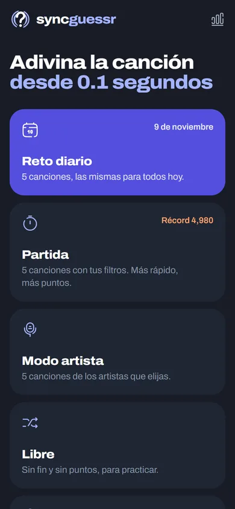&nbsp;
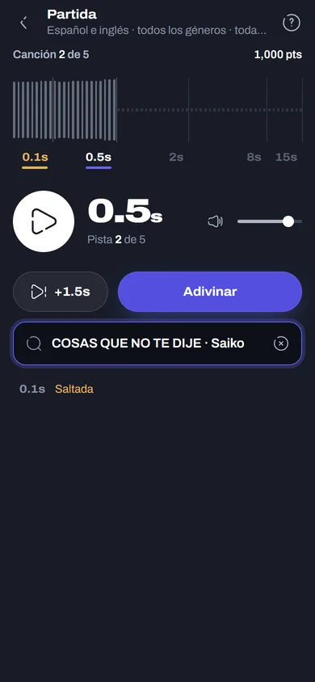&nbsp;
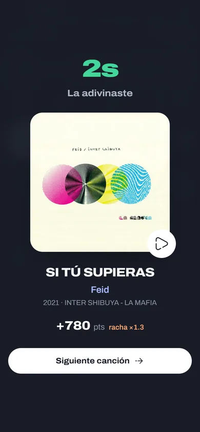&nbsp;
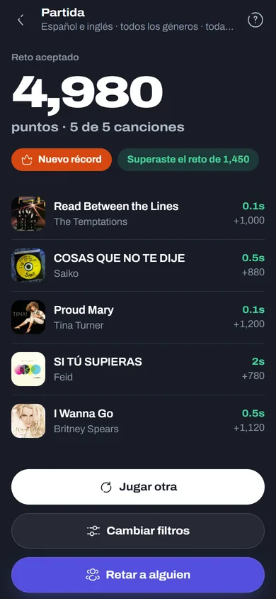

</div>

---

## What is syncguessr?

syncguessr plays a tiny slice of a song and you have to name it. You start with **0.1 seconds**;
every hint unlocks a longer fragment (0.5 s, 2 s, 8 s and 15 s), and the sooner you get it, the
more points you earn. The catalog has **over 35,000 songs in Spanish and English**, curated from
Deezer, MusicBrainz and Last.fm so that every song appears once, in its original studio version.

It is part of the **Syncora** family ([Syncora Player](https://github.com/NotJcao17/syncora-player)):
the same night palette, the Archivo typeface with its width axis, and Solar icons in the *broken*
style. The interface is in Spanish.

There are no accounts and no database: progress, records and stats live in the browser.

---

## 📸 Screenshots

<div align="center">

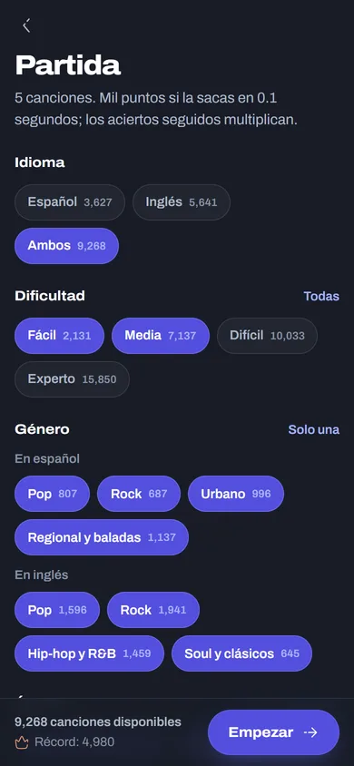&nbsp;
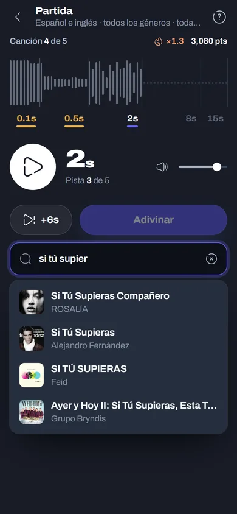&nbsp;
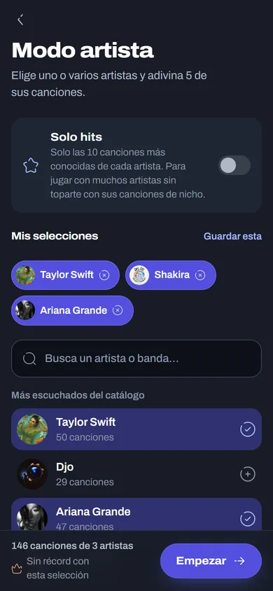&nbsp;
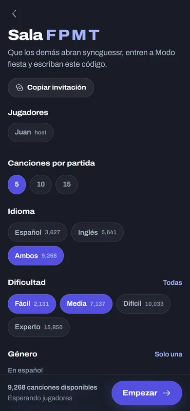

<br><br>

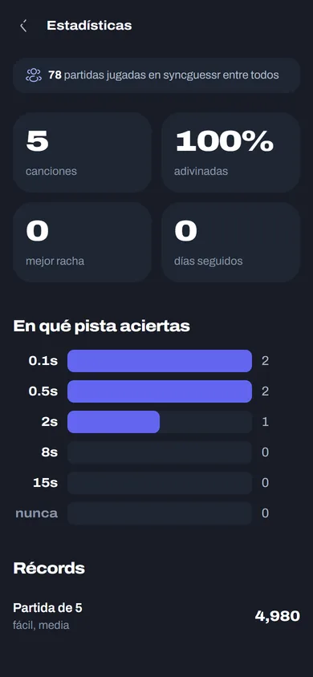&nbsp;
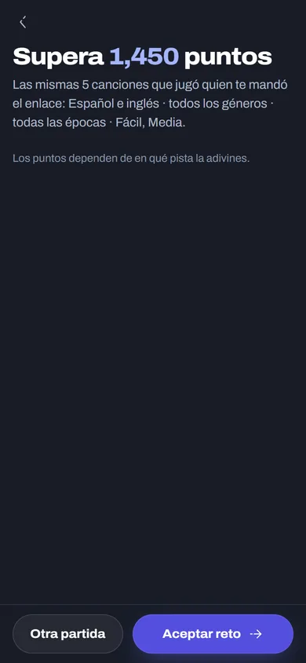

<br><br>

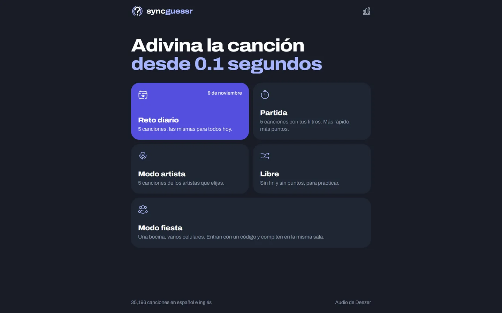

</div>

---

## 🎮 Game Modes

| Mode | How it works |
| :--- | :--- |
| 📅 **Daily challenge** | 5 songs picked by date, the same for everyone. One try per day, with a streak. |
| ⏱️ **Game** | 5 songs with your own filters. Records are kept per difficulty mix. |
| 🎤 **Artist mode** | 5 songs from the artists you choose, with a record per selection. Selections can be saved by name. |
| 🔀 **Free play** | Endless, with filters and a streak. No points, made for practice. |
| 🎵 **Your playlist** | Paste a public Spotify, Syncora Player or Deezer playlist and guess its songs (5, 10 or 20 per game), searching all of Deezer. |
| 🎉 **Party mode** | The music plays only on the host's device; the others join with a 4-letter code and guess from their phones. |

### Scoring

| Hint | 0.1 s | 0.5 s | 2 s | 8 s | 15 s |
| :--- | :---: | :---: | :---: | :---: | :---: |
| **Points** | 1000 | 800 | 600 | 400 | 200 |

- 🔥 **Streak bonus**: +10 % for each song guessed in a row, up to +50 %.
- 🎯 **Right artist, wrong song**: a quarter of the points.
- 🎶 Covers are fine: guessing the right title counts even if you pick another artist's version.

---

## ✨ Features

### Playing
- 🔊 **Web Audio engine** that starts at the first audible sound (no silent intros), with fades and
  preloading of the next fragment.
- 🔎 **Search only inside the curated catalog**: accent-insensitive, instant, and without covers,
  live versions or duplicates in the suggestions. Playlist mode searches all of Deezer instead, with
  the ranking ported from Syncora Player's search (text relevance plus popularity, a boost for the
  artist the query names, one entry per song).
- 🎛️ **Filters** by language, difficulty (easy, medium, hard, expert), genre (split by Spanish and
  English) and era, with the number of available songs on every chip.
- ⭐ **Only hits** in artist mode: just the 10 best-known songs of each artist (half if they have few).
  Every chosen artist gets the same number of turns.
- 🔁 **No repeats**: songs you already heard are stored in the browser and do not come back until
  the selection runs out (except in the daily challenge and challenge links, which must be the same
  for everyone).
- ⌨️ Keyboard shortcuts: `/` to search, `S` to skip, `N` or `Enter` for the next song.

### Sharing and competing
- 🔗 **Challenge links**: Game and Artist mode generate a link with a seed, so whoever opens it hears
  exactly the same songs and tries to beat your score.
- 📤 **Share your result** as text with squares for the hint where you got each song.
- 🎉 **Party mode over WebRTC** with PeerJS (the public PeerJS broker only makes the first contact).
  The host's browser runs the game and checks every guess with the server, so guests never see the
  round token. Each hint opens one attempt per player, and the next one opens on its own when nobody
  can keep trying.
- 📊 **Stats**: songs played, accuracy, best streak, days in a row, which hint you usually guess on,
  and your records, plus a **global counter** of games played by everyone.

### Fair play
- 🔐 Round tokens are **encrypted on the server** (`SYNCGUESSR_SECRET`), so the browser never sees
  the Deezer id of the song that is playing; audio goes through a server proxy.
- 🎵 In playlist mode the song list is also sealed: the browser gets the playlist's name, cover and
  size, and carries an encrypted list it can't read. Each round the server picks a song and, for
  Spotify, finds it on Deezer (same title, one of the same artists, closest length, no live or
  remix versions).

### Playlist sources
- **Spotify**: read from the public embed page (`open.spotify.com/embed/playlist/…`), up to 100
  songs. The Web API is not an option (Development Mode allows 5 users and its policy bars games),
  and the embed page can change without notice; if it does, only Spotify links stop working.
- **Syncora Player**: shared links (`syncoraplayer.app/playlist/<id>`) are read from Syncora's
  Supabase with its public key; songs already carry their Deezer id.
- **Deezer**: the public API (`/playlist/{id}/tracks`).

Nothing is stored on the server, and playlists over 400 songs are sampled.

---

## 🛠️ Tech Stack

| Layer | Technology |
| :--- | :--- |
| **Framework** | Next.js 16 (App Router, Route Handlers), React 19, TypeScript |
| **Styling** | Tailwind CSS 4, OKLCH tokens, Archivo variable font, Solar icons (generated from `@iconify-json/solar`) |
| **Audio** | Web Audio API over Deezer 30-second previews |
| **Multiplayer** | WebRTC with PeerJS |
| **Catalog** | Static JSON built from Deezer, MusicBrainz and Last.fm |
| **Global counter** | [Abacus](https://abacus.jasoncameron.dev) public counter API |
| **Hosting** | Vercel |

---

## 🏗️ Project Structure

```
music-guessr/
├── src/
│   ├── app/
│   │   ├── api/            # round, game, verify, search (+ search/deezer), playlist (import, round), artists, catalog, plays, stream (audio proxy)
│   │   ├── diario/         # Daily challenge
│   │   ├── partida/        # Game (filters + challenge links)
│   │   ├── artista/        # Artist mode
│   │   ├── libre/          # Free play
│   │   ├── fiesta/         # Party mode (host and guests)
│   │   ├── playlist/       # Playlist mode
│   │   ├── privacidad/     # Privacy notice
│   │   └── estadisticas/   # Personal stats
│   ├── components/         # GameScreen, StageRuler, SearchBox, RevealPanel, GameSummary, FilterPanel…
│   ├── hooks/              # useRound (one round), useGameSession (a sequence of rounds)
│   ├── lib/
│   │   ├── catalog.ts      # Filters, random pick with artist diversity, seeded pick
│   │   ├── playlists.ts    # Playlist links, import from Spotify/Syncora/Deezer, matching to Deezer
│   │   ├── deezerSearch.ts # Deezer-wide search ranking (ported from Syncora Player)
│   │   ├── audioEngine.ts  # Web Audio: start at first audible sound, fades, preloading
│   │   └── scoring.ts      # Hints and points
│   └── data/tracks.json    # The generated catalog
└── scripts/
    ├── catalog/            # Catalog pipeline (see below)
    └── gen-icons.mjs       # Builds src/components/Icon.tsx from @iconify-json/solar
```

---

## 🚀 Getting Started

```bash
git clone https://github.com/NotJcao17/syncguessr.git
cd syncguessr
npm install
npm run dev        # http://localhost:3000
```

In production set **`SYNCGUESSR_SECRET`** (any long string). It encrypts the round tokens so the
browser never sees which song is playing.

The global counter lives in Abacus because the project has no database (`/api/plays`). It adds one
when a Game, daily challenge, Artist mode or Party mode ends; Free play does not count because it
never ends.

---

## 🗂️ The Catalog

`src/data/tracks.json` is generated by the scripts in `scripts/catalog/`. `artists.mjs` is the list
of artists with their language and genre (pop, rock, urban, and "regional, ballads and soul"); to add
artists, add them there.

| Step | Script | What it does |
| :---: | :--- | :--- |
| 0 | `0-expand.mjs` | Fetches each artist's most played songs from Deezer (12 to 45 per artist). |
| 1 | `1-dedupe.mjs` | One recording per song: drops live versions, remixes, re-recordings, titles in other languages and the other-language songs of artists in `LANGUAGE_ONLY`. `CURATED` pins songs by hand and `ARTIST_IDS` fixes artists the search confused. |
| 2 | `2-enrich.mjs` | Adds missing iconic songs (`iconic.mjs`), refreshes Deezer data and looks up the original year in MusicBrainz (1 request per second, about 1 hour; cached in `scripts/catalog/.cache/`). |
| 2b | `2b-lastfm.mjs` | All-time listeners per song from Last.fm (needs `LASTFM_API_KEY`). Decides each artist's hits and raises the difficulty of songs that Deezer underrates (Deezer's rank only measures this week). Last.fm only raises songs, never lowers them. |
| 3 | `3-build.mjs` | Real year and era, and a difficulty that combines current popularity, artist fame, the song's position in the discography and age. Each level has a fixed size per language with a minimum per genre, and albums from 2025 on only contribute their 5 most played songs. |

```bash
node scripts/catalog/0-expand.mjs
node scripts/catalog/1-dedupe.mjs
node scripts/catalog/2-enrich.mjs
LASTFM_API_KEY=... node scripts/catalog/2b-lastfm.mjs
node scripts/catalog/3-build.mjs
```

---

## ⚖️ Disclaimer

syncguessr does not host any audio. Fragments come from the public 30-second previews of the Deezer
API and all songs, recordings and artwork belong to their respective owners. Not affiliated with
Deezer.

---

<div align="center">
  Part of the <a href="https://github.com/NotJcao17/syncora-player">Syncora</a> family · Created by <b>Juan Carlos Orozco Nieto</b>
</div>
